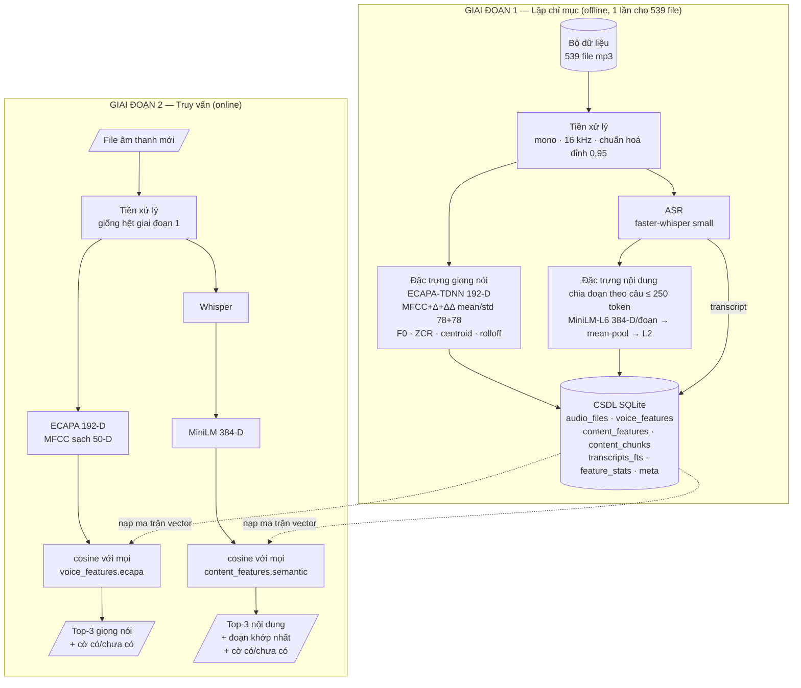

# Hệ thống tìm kiếm âm thanh theo nội dung và giọng nói

> Tài liệu cho yêu cầu **3** (CSDL), **4a** (sơ đồ khối và quy trình), **4b** (kết quả trung gian), **4c** (đánh giá) và **5** (demo).
> Phần bộ dữ liệu và nguyên lý trích đặc trưng (yêu cầu 1–2) xem [`bao_cao_phan_tich.md`](bao_cao_phan_tich.md) và [`thuat_toan_pipeline.md`](thuat_toan_pipeline.md).

## 0. Đối chiếu yêu cầu đề bài

| Yêu cầu | Đáp ứng | Ở đâu |
|---|---|---|
| 1. ≥ 500 file, mỗi file một chủ đề, một người nói | 539 file, 67,1 giờ, 4 nguồn. **508 file đạt chuẩn** (một người nói, là bài nói của người thật). 19 file biểu diễn hoặc giọng AI (`NON_TALK_FILES`) và 12 file nhiều người nói (người đọc kép, promo hoặc quảng cáo ghép nhiều giọng, phỏng vấn; `MULTI_SPEAKER_FILES`) được lưu nhưng **gắn cờ, loại khỏi tìm kiếm**. Đã bổ sung 35 bài TED một diễn giả để bù (`scripts/fetch_talks.py`, xem §7) | `data/`, bảng `audio_files` |
| 2. Hai bộ thuộc tính | Giọng nói: ECAPA 192-D + MFCC + prosody. Nội dung: transcript + vector ngữ nghĩa 384-D | `voice_features.py`, `content_features.py` |
| 3. Trích toàn bộ + CSDL quản trị | 539/539 file có đủ đặc trưng, lưu trong CSDL SQLite gồm 7 bảng (kể cả bảng FTS5) | `database.py`, `artifacts/audio_search.db` |
| 4. Tìm kiếm: top-3 nội dung + top-3 giọng nói, giảm dần | `search.py`, lệnh `search`, demo | §3–§4 |
| 4a. Sơ đồ khối, quy trình | §1, §2 | |
| 4b. Kết quả trung gian | §5 (và tab "Kết quả trung gian" trong demo) | |
| 4c. Đánh giá | §6 (`artifacts/evaluation/`) | |
| 5. Demo | `uv run streamlit run app.py`, kịch bản ở §8 | `app.py` |

---

## 1. Sơ đồ khối



Điểm mấu chốt: truy vấn **đi qua đúng pipeline của giai đoạn 1** (cùng model, cùng tham số), nên vector của truy vấn so sánh được với vector trong CSDL.

## 2. Quy trình thực hiện

### 2.1. Giai đoạn 1 — Lập chỉ mục

| Bước | Lệnh | Mô tả |
|---|---|---|
| 1 | `python -m audio_search preprocess` | Đọc mp3 bằng soundfile, nếu lỗi thì dùng ffmpeg. Trộn về mono, lấy mẫu lại 16 kHz (librosa), chuẩn hoá biên độ đỉnh về 0,95. Lưu cache WAV trong `artifacts/wav/`. |
| 2 | `python -m audio_search voice` | **MFCC:** cửa sổ 25 ms, bước nhảy 10 ms, 80 bộ lọc mel, 26 hệ số; tính thêm Δ, ΔΔ; lấy mean và std theo thời gian (78 + 78 chiều). **Prosody:** F0 bằng pYIN (60–400 Hz), ZCR, spectral centroid, rolloff 85 %. **ECAPA-TDNN:** embedding người nói 192 chiều, chuẩn hoá L2. |
| 3 | `python -m audio_search content` | **ASR:** faster-whisper small (float16 trên GPU, int8 trên CPU), beam 5, lọc VAD, ngôn ngữ `en`. **Embedding:** tách câu, gộp câu liên tiếp thành đoạn ≤ 250 token (đếm bằng tokenizer của model, không đoạn nào bị cắt, không câu nào bị bỏ); MiniLM cho vector từng đoạn; lấy trung bình rồi chuẩn hoá L2 → 384 chiều. |
| 4 | `python -m audio_search build-db` | Nạp toàn bộ JSON đặc trưng vào SQLite. Tính thống kê μ, σ của MFCC trên toàn CSDL để chuẩn hoá z-score. Gắn cờ `is_speech` và `multi_speaker`. Dựng chỉ mục FTS5. |

`reembed` tính lại riêng bước embedding từ transcript đã lưu (vài phút), không cần chạy lại Whisper trên 60 giờ âm thanh.

### 2.2. Giai đoạn 2 — Truy vấn (`search.py`)

1. **Tiền xử lý** file truy vấn: mono, 16 kHz, chuẩn hoá đỉnh. Không ghi đè cache của CSDL.
2. **Vector giọng nói:**
   - `ecapa_q` (192 chiều, L2).
   - `mfcc_q`: lấy mean + std của c1..c25 (bỏ c0 vì đó là năng lượng, phụ thuộc âm lượng chứ không phụ thuộc giọng), chuẩn hoá z-score bằng **μ, σ của CSDL** (bảng `feature_stats`), rồi chuẩn hoá L2 → 50 chiều.
3. **Vector nội dung:** Whisper ra transcript, chia đoạn, MiniLM ra `sem_q` (384 chiều, L2).
4. **So khớp:** với mọi file *i* trong CSDL:
   - `s_content(i) = sem_q · sem_i` và `s_voice(i) = ecapa_q · ecapa_i`.
   - Mọi vector đều đã chuẩn hoá L2 nên tích vô hướng chính là cosine, nằm trong [−1, 1].
   - File nhạc không lời (`is_speech = 0`) bị loại khỏi cả hai danh sách.
5. **Xếp hạng:** sắp giảm dần, lấy top-3 cho mỗi danh sách.
6. **Giải thích kết quả:** với mỗi kết quả nội dung, tìm cặp (đoạn truy vấn, đoạn trong file) có cosine lớn nhất, để chỉ ra *vì sao* file đó khớp.
7. **Quyết định có/chưa có:** nếu cosine top-1 ≥ ngưỡng thì báo "đã có trong CSDL", ngược lại báo "có thể chưa có", kèm 3 file gần nhất. Ngưỡng được hiệu chỉnh tự động từ dữ liệu (§6.2).
8. **Baseline** hiển thị kèm để so sánh: MFCC 50-D (giọng nói) và BM25 trên FTS5 (nội dung).

---

## 3. CSDL đặc trưng (`artifacts/audio_search.db`)

**Vì sao chọn SQLite:** là hệ quản trị CSDL quan hệ thực thụ (giao dịch, khoá ngoại, chỉ mục, SQL), có sẵn trong Python, không cần máy chủ, nên chạy được trên máy sinh viên và khi demo. FTS5 cho chỉ mục full-text trên transcript mà không cần cài thêm gì.

| Bảng | Khoá | Nội dung |
|---|---|---|
| `audio_files` | `file_id` | Metadata: nguồn, người nói, chủ đề, khoá học (đều suy ra từ tên file), thời lượng, `is_speech`, `multi_speaker`, đường dẫn |
| `voice_features` | `file_id` → audio_files | `ecapa` BLOB float32[192], `mfcc_mean`/`mfcc_std` float32[78], `mfcc_clean` float32[50], F0, ZCR, centroid, rolloff |
| `content_features` | `file_id` → audio_files | `transcript`, `n_chunks`, `semantic` float32[384], runtime ASR, phiên bản đặc trưng |
| `content_chunks` | (`file_id`, `chunk_idx`) | Văn bản từng đoạn + vector 384 chiều (2 796 đoạn) |
| `transcripts_fts` | FTS5 | Chỉ mục full-text (porter stemmer), xếp hạng BM25 |
| `feature_stats` | `name` | μ, σ của MFCC 50-D để chuẩn hoá truy vấn |
| `meta` | `key` | Model, phiên bản đặc trưng, thời điểm dựng |

Có chỉ mục B-tree trên `source`, `speaker`, `course`. Ví dụ truy vấn:

```sql
-- Các file cùng khoá học (cùng người giảng) và thời lượng
SELECT file_id, duration_s FROM audio_files WHERE course = 'Intro to CS - Python' ORDER BY file_id;
-- Full-text: những bài nhắc tới vi khuẩn, kèm đoạn trích
SELECT file_id, snippet(transcripts_fts, 1, '[', ']', '…', 12) FROM transcripts_fts
WHERE transcripts_fts MATCH 'bacteria' ORDER BY bm25(transcripts_fts) LIMIT 5;
```

**Tìm kiếm vector và chỉ mục:**
- Khi chạy, `load_index()` nạp mỗi họ vector thành một ma trận numpy (539 × 192, 539 × 384, 539 × 50; truy vấn chỉ so với 508 file đạt chuẩn). Một truy vấn chỉ là một phép nhân ma trận–vector.
- Đây là **quét tuyến tính chính xác**, độ phức tạp O(N·d): với N = 539 và d = 384 là khoảng 0,2 triệu phép nhân-cộng, đo được **~10–20 ms**, gồm cả việc tìm đoạn khớp nhất và truy vấn FTS.
- Với N cỡ hàng triệu, cần thay bằng chỉ mục gần đúng (HNSW, IVF-PQ hoặc pgvector). Lớp `VectorIndex` là điểm để cắm vào.
- Không dùng KD-tree / R-tree vì ở số chiều 192–384 chúng suy biến về quét toàn bộ (lời nguyền số chiều).

---

## 4. Vì sao chọn các đặc trưng này cho tìm kiếm

- **Giọng nói — ECAPA:**
  - Được huấn luyện để phân biệt 7 000+ người nói (VoxCeleb) bằng hàm mất mát AAM-softmax. Không gian embedding được tối ưu sao cho cùng người thì gần, khác người thì xa, và bất biến với nội dung lời nói.
  - MFCC trung bình mô tả *âm sắc trung bình* nhưng lẫn ảnh hưởng của micro, phòng thu và nội dung, nên chỉ làm baseline.
  - MFCC đã được làm sạch: bỏ c0 và các khối Δ/ΔΔ (trung bình theo thời gian ≈ 0), chuẩn hoá z-score. Bản thô có cosine trung bình 0,994 giữa *mọi* cặp file, nên không dùng được.
- **Nội dung — transcript + sentence embedding:**
  - Nội dung bài nói mang tính ngôn ngữ, nên chuyển sang văn bản là cách trực tiếp nhất.
  - Sentence embedding bắt được **nghĩa** chứ không chỉ từ khoá: truy vấn kể lại câu chuyện bằng lời khác vẫn tìm ra (§6.3, q3).
  - BM25 chỉ đếm từ trùng nhau, dùng làm baseline.

---

## 5. Kết quả trung gian (yêu cầu 4b)

Kết quả trung gian của mỗi truy vấn được in ra bởi lệnh `search` và hiển thị trong tab **Kết quả trung gian** của demo. Gồm:
- Vector đặc trưng: chuẩn L2 và vài giá trị đầu; đầy đủ trong demo.
- Prosody: F0, ZCR, centroid, rolloff.
- Transcript và các đoạn văn bản.
- Thời gian từng bước.
- Cosine của top-3 (top-10 trong demo).
- Đoạn văn bản khớp nhất của mỗi kết quả nội dung.
- Kết quả của các baseline.

### 5.1. Nội dung + người nói **đã có**: `q7` (45 s cắt từ một bài TED, qua bộ lọc điện thoại 300–3400 Hz và nhiễu 15 dB)

```text
QUERY: q7_real_ted_clip_rerecorded.wav  (45.0 s)

── Intermediate results ─────────────────────────────────────────
ECAPA-TDNN 192-D      ‖v‖=1.000  [+0.109, +0.078, -0.055, +0.014, -0.070, +0.163, …]
MFCC clean 50-D       ‖v‖=1.000  [-0.359, -0.065, -0.196, -0.119, -0.099, -0.032, …]
Prosody               F0=206.6±27.0 Hz  ZCR=0.2711  centroid=2872 Hz  rolloff=5547 Hz
Semantic 384-D        ‖v‖=1.000  [-0.068, +0.042, +0.095, +0.006, +0.064, -0.019, …]  (1 chunk(s))
Transcript (643 chars): for the first time from this fraction of the petroleum data from 2023 it shows that extraction of virgin plastic has increased so that means that we are promoting recycling and also virgin production plastic is increasing so this is the perfect illusion of sustainability if we do nothing in 2050 the…
Timings: preprocess_s=0.01, mfcc_prosody_s=7.35, ecapa_s=2.26, asr_s=8.26, embed_s=13.93, search=11.5 ms

── TOP-3 CONTENT (semantic cosine) → content FOUND in DB (threshold 0.63)
  1. cos=0.7498  The_Brilliance_of_Bacteria_(and_How_They_Combat_Waste)_Patricia_Aymà_Maldonado_TED
       source=TED  speaker/course=Aymà_Maldonado  duration=392s
       best passage (cos=0.875): And only 9% of the plastic in the world is recycled. 90% of the plastic is incinerated and 50% goes to landfills. When it gets recycled, it loses quality. So it…
  2. cos=0.5425  The_Controversial_Climate_Tool_Funding_Real_Change_Sandeep_Roy_Choudhury_TED
       source=TED  speaker/course=Roy_Choudhury  duration=536s
       best passage (cos=0.492): A farmer transitioning to a cleaner practice is being paid for a service. It's not a dole-out. These people, these programs, have nowhere else to go for money. …
  3. cos=0.5421  Your_Empty_Wine_Bottle_Could_Help_Rebuild_Coastlines_Franziska_Trautmann_TED
       source=TED  speaker/course=Franziska_Trautmann  duration=333s
       best passage (cos=0.511): including toothpaste, by the way. And the last puzzle piece we found was this small, human-sized machine that could crush one bottle at a time into sand, and we…

── TOP-3 VOICE (ECAPA cosine) → speaker FOUND in DB (threshold 0.63)
  1. cos=0.7170  The_Brilliance_of_Bacteria_(and_How_They_Combat_Waste)_Patricia_Aymà_Maldonado_TED
       source=TED  speaker/course=Aymà_Maldonado  duration=392s
  2. cos=0.2869  How_to_Choose_Clothes_for_Longevity,_Not_the_Landfill_Diarra_Bousso_TED
       source=TED  speaker/course=Diarra_Bousso  duration=648s
  3. cos=0.2736  The_Rise_of_Virtual_Humans_—_and_What_They_Mean_for_the_Future_Sara_Giusto_TED
       source=TED  speaker/course=Sara_Giusto  duration=627s

── Baseline voice: MFCC 50-D cosine 
  1. cos=0.6797  How_I_Turn_Joy_into_Art_Yinka_Ilori_TED
       source=TED  speaker/course=Yinka_Ilori  duration=510s
  2. cos=0.6307  Meet_Our_Planet's_Hidden_Defenders_Anjan_Sundaram_TED
       source=TED  speaker/course=Anjan_Sundaram  duration=593s
  3. cos=0.6002  How_I’m_Helping_Thousands_Rebuild_Their_Lives_After_Prison_Susan_Burton_TED
       source=TED  speaker/course=Susan_Burton  duration=739s

── Baseline content: BM25 keyword (FTS5) 
  1. bm25=126.9567  The_Brilliance_of_Bacteria_(and_How_They_Combat_Waste)_Patricia_Aymà_Maldonado_TED
       source=TED  speaker/course=Aymà_Maldonado  duration=392s
  2. bm25=45.5467  The_Unsung_Heroes_Putting_Climate_Solutions_Into_Practice_Aline_Sousa_TED
       source=TED  speaker/course=Aline_Sousa  duration=394s
  3. bm25=31.1695  How_the_Wealth_Gap_Is_Reshaping_Politics_Xochitl_Gonzalez_TED
       source=TED  speaker/course=Xochitl_Gonzalez  duration=636s
```

**Nhận xét:**
- Cả hai danh sách đều đúng file nguồn ở top-1.
- Danh sách giọng nói tách biệt rất rõ: 0,717 so với 0,287 ở vị trí thứ 2.
- Đoạn khớp nhất (cos 0,875) cho thấy *vì sao* file này được chọn: cùng nói về tỉ lệ tái chế nhựa.
- Baseline MFCC sai hoàn toàn khi tín hiệu bị biến dạng kênh truyền. BM25 vẫn đúng vì transcript trùng từ.

### 5.2. Nội dung + người nói **chưa có**: `q4` (giọng TTS "David" nói về bánh mì sourdough)

```text
QUERY: q4_tts_david_new_topic_sourdough.wav  (47.7 s)

── Intermediate results ─────────────────────────────────────────
ECAPA-TDNN 192-D      ‖v‖=1.000  [+0.008, +0.029, -0.048, -0.031, +0.014, -0.022, …]
MFCC clean 50-D       ‖v‖=1.000  [+0.064, -0.112, +0.119, -0.027, +0.087, -0.003, …]
Prosody               F0=90.4±11.7 Hz  ZCR=0.1607  centroid=1584 Hz  rolloff=2762 Hz
Semantic 384-D        ‖v‖=1.000  [-0.017, -0.044, +0.008, +0.058, -0.028, +0.070, …]  (1 chunk(s))
Transcript (761 chars): Today I want to explain how sourdough bread works. Instead of commercial yeast, a sourdough starter is a living culture of wild yeasts and lactic acid bacteria that you feed with flour and water every day. When you mix the starter into the dough, the yeasts produce carbon dioxide which makes the loa…
Timings: preprocess_s=4.01, mfcc_prosody_s=3.35, ecapa_s=2.44, asr_s=8.51, embed_s=10.38, search=8.1 ms

── TOP-3 CONTENT (semantic cosine) → content probably NOT in DB (threshold 0.63)
  1. cos=0.2585  002_What is computer science？ ｜ Intro to CS - Python ｜ Khan Academy
       source=KhanAcademy  speaker/course=Intro to CS - Python  duration=345s
       best passage (cos=0.266): and you ask them to follow it and you see what they do. Maybe they come back and the cake is slightly burnt or the little frosting swirlies go in clockwise inst…
  2. cos=0.2320  035_Demonstrate, Hypothesis, Accurate ｜ Vocabulary ｜ Khan Academy
       source=KhanAcademy  speaker/course=Vocabulary  duration=244s
       best passage (cos=0.201): If you speak Spanish or French, you might recognize the verb to show, mostrar in Spanish or montrer in French. But you might also see the English word monster, …
  3. cos=0.2263  040_First and secondhand accounts ｜ Reading ｜ Khan Academy
       source=KhanAcademy  speaker/course=Reading  duration=260s
       best passage (cos=0.206): our young migrant on the Oregon Trail. July 18th, 1871. We're in the Wyoming territory now, and it's been a few days since we had good water. I'm starting to wo…

── TOP-3 VOICE (ECAPA cosine) → speaker probably NOT in DB (threshold 0.63)
  1. cos=0.2554  090_Zeros of polynomials introduction ｜ Polynomial graphs ｜ Algebra 2 ｜ Khan Academy
       source=KhanAcademy  speaker/course=Polynomial graphs  duration=308s
  2. cos=0.2476  'Petey_Perfectpants_and_the_Silly_Sock_Puppet_Problem'_read_by_Adam_Brody
       source=Storybook  speaker/course=Adam_Brody  duration=415s
  3. cos=0.2433  098_Zeros of polynomials (multiplicity) ｜ Polynomial graphs ｜ Algebra 2 ｜ Khan Academy
       source=KhanAcademy  speaker/course=Polynomial graphs  duration=300s

── Baseline voice: MFCC 50-D cosine 
  1. cos=0.6605  025_Submerge, Profound ｜ Vocabulary ｜ Khan Academy
       source=KhanAcademy  speaker/course=Vocabulary  duration=206s
  2. cos=0.6311  031_Part-to-whole relationships in text structure ｜ Reading ｜ Khan Academy
       source=KhanAcademy  speaker/course=Reading  duration=282s
  3. cos=0.6248  A_Hospital_in_the_Cloud_Bringing_Health_Care_Anywhere_in_the_World_Mohamed_Aburawi_TED
       source=TED  speaker/course=Mohamed_Aburawi  duration=299s

── Baseline content: BM25 keyword (FTS5) 
  1. bm25=36.5489  Our_Savory,_Spicy,_Significant_Relationship_With_Food_June_Jo_Lee_TED
       source=TED  speaker/course=Jo_Lee  duration=493s
  2. bm25=31.0300  Do_Gut_Microbes_Control_Your_Personality_Kathleen_McAuliffe_TED
       source=TED  speaker/course=Kathleen_McAuliffe  duration=611s
  3. bm25=30.6314  The_Brilliance_of_Bacteria_(and_How_They_Combat_Waste)_Patricia_Aymà_Maldonado_TED
       source=TED  speaker/course=Aymà_Maldonado  duration=392s
```

**Nhận xét:**
- Cosine top-1 rất thấp ở cả hai danh sách: nội dung 0,26 và giọng 0,26, đều dưới ngưỡng ≈ 0,63 của cả hai. Hệ thống đúng khi báo "chưa có trong CSDL" mà vẫn trả về 3 file gần nhất như đề yêu cầu.
- BM25 không có khái niệm này: nó vẫn trả về các bài nhắc tới "food", "bacteria" với điểm cao. Đây là lý do dùng điểm ngữ nghĩa để quyết định.

File đầy đủ: `artifacts/evaluation/example_*.txt`.

---

## 6. Đánh giá (yêu cầu 4c)

Chạy lại: `uv run python -m audio_search evaluate` (khoảng 20 phút trên GTX 1650). Mọi số liệu dưới đây sinh tự động vào `artifacts/evaluation/summary.md`, `results.json`, `e1_clips.csv`.

**Thiết kế 3 thí nghiệm:**
- **E1. Tìm lại file nguồn từ đoạn cắt.** Lấy 60 file có lời nói, chọn ngẫu nhiên phân tầng theo nguồn (seed 7). Mỗi file cắt một đoạn 60 s ở vị trí ngẫu nhiên. Hai điều kiện:
  - *clean*: giữ nguyên đoạn cắt.
  - *degraded*: lọc dải điện thoại 300–3400 Hz và thêm nhiễu trắng SNR 15 dB, giả lập thu lại qua micro khác.
  - Đáp án đúng là file nguồn, cho cả nội dung lẫn giọng nói.
- **Hiệu chỉnh ngưỡng.** Chạy lại các truy vấn E1 sau khi **loại file nguồn khỏi CSDL**: lúc này bài nói và người nói đó "chưa có trong CSDL". So phân bố cosine top-1 giữa hai trường hợp có và chưa có, vẽ ROC, chọn ngưỡng tối ưu theo chỉ số Youden. Với giọng nói, trường hợp "chưa có" chỉ tính khi người nói không còn file nào khác trong CSDL.
- **E2. Nhận diện người nói kiểu leave-one-out** trên vector của cả file. Nhãn người nói lấy theo tên file, hoặc theo khoá học Khan Academy (một khoá do một người giảng). Gồm 20 nhóm có ≥ 2 file, tổng 158 truy vấn.
- **E3. Bộ truy vấn mẫu** `samples/queries/` (sinh bằng `scripts/make_queries.py`):
  - Giọng TTS (David, Zira, không có trong CSDL) đọc đoạn transcript đã có, kể lại câu chuyện bằng lời của nhóm, hoặc nói về chủ đề mới.
  - Đoạn cắt giọng thật và bản thu lại của nó.
  - **Giọng người thật không có trong CSDL** (`human_*`, thêm bằng `scripts/add_query.py`): hai đoạn 45 s của diễn giả Mark Rober (bài TED dài 40 phút, nằm ngoài 539 file). Một bản sạch, một bản qua dải điện thoại và nhiễu. Cả người nói lẫn bài nói đều "chưa có".


### E1. Tìm lại file nguồn từ đoạn cắt 60 s (60 file, 2 điều kiện)

| Điều kiện | Phương pháp | Hit@1 | Hit@3 | MRR |
|---|---|---|---|---|
| clean | semantic | 90.0% | 96.7% | 0.936 |
| clean | bm25 | 100.0% | 100.0% | 1.000 |
| clean | ecapa | 100.0% | 100.0% | 1.000 |
| clean | mfcc | 93.3% | 98.3% | 0.957 |
| degraded | semantic | 88.3% | 96.7% | 0.925 |
| degraded | bm25 | 100.0% | 100.0% | 1.000 |
| degraded | ecapa | 81.7% | 90.0% | 0.864 |
| degraded | mfcc | 1.7% | 1.7% | 0.040 |

### Ngưỡng "có / chưa có trong CSDL" (hiệu chỉnh từ E1, ROC)

| Bộ đặc trưng | AUC | Ngưỡng | TPR | FPR | Độ chính xác | TB có | TB chưa có |
|---|---|---|---|---|---|---|---|
| semantic_known | 0.875 | 0.626 | 84.2% | 22.5% | 80.8% | 0.721 | 0.530 |
| ecapa_known | 0.964 | 0.625 | 99.4% | 11.6% | 95.4% | 0.843 | 0.460 |

### E2. Nhận diện người nói (leave-one-out, 20 nhóm người nói ≥ 2 file)

| Đặc trưng | Số truy vấn | P@1 | P@3 | mAP |
|---|---|---|---|---|
| ecapa | 158 | 79.1% | 69.8% | 0.672 |
| mfcc | 158 | 68.4% | 62.4% | 0.600 |

### E3. Bộ truy vấn mẫu (samples/queries)

| File | Loại | Top-1 nội dung (cos) | Đúng? | Top-1 giọng (cos) | Đúng? |
|---|---|---|---|---|---|
| q1_tts_david_ted_excerpt.wav | known_content_new_speaker | How_to_Fix_Africa’s_Learning_Crisis_Rapelang_ (0.634) | ✅ | 090_Zeros of polynomials introduction ｜  (0.266) | ✅ |
| q2_tts_zira_khan_excerpt.wav | known_content_new_speaker | 028_Games and modularity ｜ Intro to CS - Pyth (0.796) | ✅ | The_Art_of_Disagreeing_with_Dignity_Tami (0.293) | ✅ |
| q3_tts_zira_story_paraphrase.wav | known_content_new_speaker | 'Harry_the_Dirty_Dog'_read_by_Betty_White (0.709) | ✅ | The_Art_of_Disagreeing_with_Dignity_Tami (0.279) | ✅ |
| q4_tts_david_new_topic_sourdough.wav | new_content_new_speaker | 002_What is computer science？ ｜ Intro to CS - (0.259) | ✅ | 090_Zeros of polynomials introduction ｜  (0.255) | ✅ |
| q5_tts_zira_new_topic_photosynthesis.wav | new_content_new_speaker | The_Tiny_Organisms_Transforming_Farming_Karst (0.347) | ✅ | The_Art_of_Disagreeing_with_Dignity_Tami (0.361) | ✅ |
| q6_real_ted_clip.wav | known_content_known_speaker | The_Brilliance_of_Bacteria_(and_How_They_Comb (0.731) | ✅ | The_Brilliance_of_Bacteria_(and_How_They (0.960) | ✅ |
| q7_real_ted_clip_rerecorded.wav | known_content_known_speaker | The_Brilliance_of_Bacteria_(and_How_They_Comb (0.750) | ✅ | The_Brilliance_of_Bacteria_(and_How_They (0.717) | ✅ |
| human_mark_rober_talk_clip.wav | new_content_new_speaker | The_Difference_Between_False_Empathy_and_True (0.348) | ✅ | 'Snappsy_The_Alligator_(Did_Not_Ask_to_B (0.353) | ✅ |
| human_mark_rober_talk_clip_phone.wav | new_content_new_speaker | This_Is_How_Kids_Should_Be_Learning_with_AI_P (0.497) | ✅ | 047_Polynomial special products： perfect (0.355) | ✅ |

Với truy vấn có người nói/nội dung *chưa có*, "đúng" nghĩa là hệ thống báo điểm top-1 dưới ngưỡng (chưa có trong CSDL).


### 6.1. Phân tích

1. **Nội dung:** khi bài nói có trong CSDL, top-1 đúng **90 %** với đoạn cắt sạch và **88,3 %** khi bị biến dạng. Hit@3 đạt **96,7 %** ở cả hai điều kiện, tức hầu hết ca sai chỉ lệch xuống hạng 2–4. Các ca sai có lý do rõ ràng:
   - **Nhiều bài cùng chủ đề**: video Khan Academy "Solving exponential equation" xếp sau các video logarit khác cùng khoá; nhiều bài TED cùng nói về AI và tương lai công nghệ. Về ngữ nghĩa, kết quả này không sai.
   - **Truyện thiếu nhi**: đoạn Vooks có nhạc nền nên chỉ nhận dạng được khoảng 300 ký tự, và vector của đoạn ngắn này gần với các truyện khác. "La nevera de Maddi" là bản tiếng Tây Ban Nha, trong khi MiniLM chỉ cho tiếng Anh (§7).
   - **Đoạn cắt lệch ý chính**: với "Why You Should Disappoint Your Parents" (hạng 13–14), đoạn 60 s không đại diện cho cả bài. Đây là nhược điểm của vector trung bình cả file (§7).
2. **BM25 đạt 100 % ở E1** vì đoạn cắt lấy **từ chính bản ghi**: câu chữ trùng gần như tuyệt đối, rất có lợi cho so khớp từ khoá. Khi người khác **diễn đạt lại** nội dung thì lợi thế đảo ngược: q3 (kể lại "Harry the Dirty Dog") đạt cosine 0,709, cao hơn hẳn mọi file khác. Quan trọng hơn, điểm BM25 không có thang tuyệt đối nên **không quyết định được "chưa có trong CSDL"** (§5.2). Vì thế hệ thống xếp hạng bằng ngữ nghĩa và dùng BM25 làm đối chứng.
3. **Giọng nói: ECAPA vượt trội MFCC khi kênh truyền thay đổi.**
   - Với đoạn cắt sạch, ECAPA đạt **100 %**, MFCC đạt 93,3 %.
   - Với bản thu lại, ECAPA giữ được **81,7 % Hit@1 (90 % Hit@3)**, còn MFCC rơi xuống **1,7 %**. MFCC trung bình mô tả cả *kênh truyền*, còn ECAPA được huấn luyện để bất biến với kênh.
   - **Cả 11 ca ECAPA "sai" khi bị biến dạng đều là video Khan Academy**: những file xếp trên file nguồn là **các video khác của cùng người giảng**. Ở mức người nói, kết quả vẫn đúng.
   - Trong một lần chạy trước, ECAPA không tìm lại được chính file nguồn của bài "How You Could See Inside Your Body…" (hạng 8 với đoạn cắt sạch). Kiểm tra lại thì bài này **có hai diễn giả**. Nhờ vậy E1 đã giúp phát hiện các file vi phạm tiêu chí "một người nói" (§7).
4. **Nhận diện người nói giữa các bản ghi khác nhau (E2):** ECAPA đạt P@1 **79,1 %**, mAP 0,672; MFCC đạt 68,4 % và 0,600. Đây là thước đo sát nhất với yêu cầu "giọng nói giống nhất", vì truy vấn và kết quả là hai bản ghi khác nhau. 35 bài TED bổ sung đều của diễn giả mới, nên các nhóm E2 không đổi.
5. **Quyết định có/chưa có:**
   - Giọng nói: AUC **0,964**, độ chính xác **95,4 %** tại ngưỡng 0,625. Hai phân bố tách xa nhau: trung bình 0,84 so với 0,46.
   - Nội dung: AUC 0,875, độ chính xác 80,8 % tại ngưỡng 0,626. Kém hơn vì CSDL có nhiều bài **cùng chủ đề**. Khi bỏ file nguồn, file "anh em" vẫn cho cosine cao, nên thực chất bài đó không hẳn là "chưa có".
   - **Ngưỡng nội dung dao động giữa các lần chạy** (0,64 → 0,70 → 0,63 khi tập file đạt chuẩn thay đổi), vì chỉ hiệu chỉnh trên 60 đoạn và hai phân bố chồng lấn nhau. Ngưỡng giọng nói ổn định hơn (0,60–0,65). Nên đọc ngưỡng nội dung như một gợi ý và luôn xem kèm top-3.
6. **E3: 9/9 truy vấn mẫu đúng** cả hai danh sách:
   - Nội dung đã có, đọc bằng giọng TTS mới (q1–q3): đúng file ở top-1, kể cả bản diễn đạt lại. q1 (0,634) chỉ vừa vượt ngưỡng 0,626.
   - Giọng TTS luôn bị báo "chưa có" (cos ≤ 0,36).
   - Chủ đề mới (q4, q5) bị báo "chưa có" (cos ≤ 0,35).
   - Giọng thật của người có trong CSDL (q6, q7): đúng cả nội dung lẫn người nói, kể cả khi thu lại qua dải điện thoại.
   - **Giọng thật của người chưa có trong CSDL** (Mark Rober, bản sạch và bản điện thoại): giọng bị báo "chưa có" (ECAPA ≈ 0,35). Nội dung trả về đúng các bài về giáo viên và học tập nhưng vẫn dưới ngưỡng (0,35–0,50).
7. **Thời gian:** khoảng 25–35 s cho một truy vấn 45 s trên GTX 1650. Phần lớn là Whisper và việc khởi động model ở lần đầu; ở demo, model được giữ sẵn trong bộ nhớ. Bước so khớp với CSDL chỉ **~10 ms**.

---

## 7. Hạn chế và hướng khắc phục

| Hạn chế | Ảnh hưởng | Hướng khắc phục |
|---|---|---|
| **15 file TED là biểu diễn nhạc/múa** (6 không lời, 9 bài hát; tốc độ lời < 2,5 ký tự/s so với trung vị 13,3) | Vi phạm tiêu chí "bài nói"; giọng hát không đại diện giọng nói | **Đã xử lý:** liệt kê trong `config.NON_TALK_FILES`, gắn `is_speech = 0`, loại khỏi cả hai danh sách tìm kiếm và khỏi số đếm; bổ sung 35 bài TED một diễn giả (4–15 phút, tốc độ lời 7,9–17,5 ký tự/s, đã đọc transcript) → cùng hai dòng dưới, còn 508 file đạt chuẩn |
| **12 file nhiều người nói**: 5 truyện có hai người đọc (ví dụ "…Kevin Costner and Jillian Estell"), 3 promo Storyline Online ghép lời nhiều diễn viên, 1 quảng cáo Vooks và 1 bài TED nhảy kèm phỏng vấn (Sean Bankhead), 2 bài TED có hai diễn giả (Kapono & Fox, Luebke & Kumbhari; phát hiện vì ECAPA không tìm lại được chính file nguồn ở E1) | Vector ECAPA trộn nhiều giọng | **Đã xử lý:** gắn cờ `multi_speaker` (theo tên file, cộng danh sách `config.MULTI_SPEAKER_FILES`), loại khỏi tìm kiếm, vẫn lưu trong CSDL để tra cứu |
| **4 file không phải bài nói của người thật**, tìm ra khi đọc transcript của các file có tốc độ lời thấp: tiết mục "Xiuhtezcatl Performing…", "The World's First AI TED Talk" (giọng do AI tạo), Wallis Bird (hát 3 bài), PARTYOF2 (rap) | Không phải "bài nói" theo nghĩa của đề | **Đã xử lý:** đưa vào `NON_TALK_FILES` |
| **Ca giáp ranh được giữ lại**: truyện Vooks đọc chậm, có nhạc nền và một câu quảng cáo cuối bằng giọng khác ("Farm Animals for Kids" chỉ có 391 ký tự lời); bài thơ và nói của Elle Cordova, cuối bài có một bài hát | Vẫn là một người kể hoặc nói về một chủ đề, nên vẫn tính | Nếu giảng viên đòi chặt hơn: tải thêm bài TED bằng `scripts/fetch_talks.py --count N`, chạy `all` → `build-db` |
| **Ít người nói có nhiều file** (20 nhóm, phần lớn là khoá học Khan Academy) | Nhãn người nói là *nhãn yếu* (khoá học ≈ người giảng) | Bổ sung nhiều bài TED của cùng diễn giả, hoặc mỗi thành viên tự thu 5–10 file |
| **Truy vấn "người khác đọc nội dung đã có" mới dùng giọng TTS** | Ca "người nói mới" bằng giọng thật đã có (Mark Rober, `human_*`), nhưng ca "người thật đọc lại nội dung có trong CSDL" thì chưa | Mỗi thành viên thu khoảng 30 s đọc lại một đoạn truyện có trong CSDL, rồi chạy `uv run python scripts/add_query.py <file> --content <file_id>` và `evaluate`. Demo cũng cho ghi âm trực tiếp |
| **MiniLM chỉ cho tiếng Anh**; Whisper được ghim `en` | Không tìm được truy vấn tiếng Việt, cũng không khớp được bản tiếng Tây Ban Nha "La nevera de Maddi" với "Maddi's Fridge" | Đổi sang `paraphrase-multilingual-MiniLM-L12-v2` (cũng 384 chiều), đặt `QUERY_WHISPER_LANGUAGE = None`, chạy `reembed` → `build-db` |
| **Vector nội dung lấy trung bình cả file** | Bài nói nhiều ý thì vector bị "loãng" | Đã lưu vector từng đoạn (`content_chunks`). Có thể xếp hạng theo max-sim giữa các đoạn |
| **Quét tuyến tính** | Đủ nhanh cho N = 539, không mở rộng tới hàng triệu file | Thay `VectorIndex` bằng HNSW (hnswlib / FAISS) hoặc pgvector |

## 8. Kịch bản demo

```powershell
uv run streamlit run app.py      # mở http://localhost:8501
```

1. **Tab Sơ đồ khối:** trình bày kiến trúc và quy trình.
2. **Tab CSDL:** duyệt 539 bản ghi, lọc theo nguồn hoặc cờ, xem lược đồ SQL, chạy thử truy vấn FTS5.
3. **Tab Tìm kiếm → File mẫu:**
   - `q6` (giọng thật, có trong CSDL): đúng file ở top-1 cả hai danh sách, điểm ECAPA ≈ 0,96.
   - `q7` (q6 qua điện thoại + nhiễu): vẫn đúng, cho thấy độ bền.
   - `q3` (TTS kể lại "Harry the Dirty Dog" bằng lời khác): nội dung đúng ở top-1; giọng báo "chưa có trong CSDL".
   - `q4`/`q5` (chủ đề mới): cả hai danh sách báo "chưa có", vẫn liệt kê 3 file gần nhất.
4. **Ghi âm trực tiếp** (st.audio_input) hoặc **Tải file lên:** một thành viên đọc một đoạn truyện có trong CSDL, hoặc nói về một chủ đề tuỳ ý.
5. **Ô "Loại khỏi CSDL":** nhập `file_id` của chính file nguồn để thấy hệ thống chuyển sang trạng thái "chưa có".
6. Mở **Kết quả trung gian:** transcript, các đoạn văn bản, biểu đồ vector ECAPA/semantic/MFCC, prosody, top-10 cosine, baseline, thời gian từng bước.
7. **Tab Đánh giá:** bảng và biểu đồ của §6.
