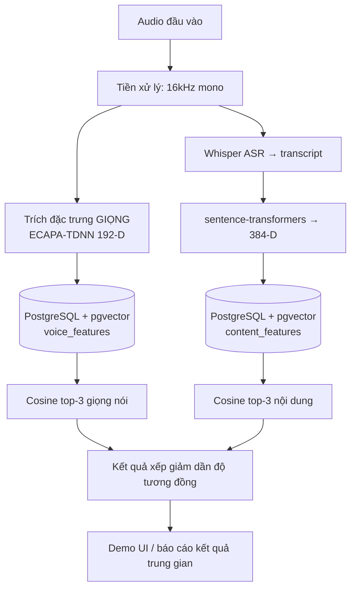

# Kế hoạch thực hiện dự án: Hệ CSDL lưu trữ và tìm kiếm âm thanh theo nội dung

> Vai trò: tài liệu nghiên cứu & kế hoạch triển khai cho bài tập lớn môn **Hệ CSDL đa phương tiện và ứng dụng (HCSDLDPT)**.
> Nhóm: **3 người** · Thời gian dự kiến: **6–7 tuần**.

---

"Xây dựng hệ CSDL lưu trữ và tìm kiếm âm thanh theo nội dung. 

1.Hãy xây dựng/sưu tầm một bộ dữ liệu gồm ít nhất 500 files âm thanh về các bài diễn thuyết, hoặc bài giảng, hoặc các lời kể chuyện có nội dung nhất định. Các files có độ dài phù hợp để chứa được nội dung về một vấn đề nào đó, mỗi file có nội dung về một chủ đề, do một người nói / diễn thuyết (SV tùy chọn định dạng file âm thanh). Hãy trình bày các đặc điểm về nội dung và âm thanh của các files dữ liệu. 

2.Hãy xây dựng 2 bộ thuộc tính của các files âm thanh trong bộ dữ liệu: một bộ thuộc tính về giọng nói của người diễn thuyết/kể chuyện, một bộ thuộc tính về nội dung câu chuyện/bài giảng/diễn thuyết trong file âm thanh. Trình bày về nguyên lý trích rút các đặc trưng nói trên và cách sử dụng các đặc trưng này. 

3.Sử dụng các công cụ/thuật toán cần thiết để trích rút toàn bộ các giá trị đặc trưng được đề cập ở bước 2. Xây dựng một CSDL để quản trị toàn bộ các đặc trưng của tất cả các files dữ liệu. 

4.Xây dựng hệ thống tìm kiếm file âm thanh với đầu vào là một file âm thanh mới do một người nói về một nội dung đã có và chưa có trong dữ liệu, đầu ra gồm 2 phần, một phần là 3 files âm thanh giống nhất về nội dung chứa trong file âm thanh đầu vào, và một phần là 3 files âm thanh có giọng nói giống nhất với giọng nói trong file đầu vào, các file kết quả xếp thứ tự giảm dần về độ tương đồng với file âm thanh đầu vào. a.Trình bày sơ đồ khối của hệ thống và quy trình thực hiện yêu cầu của đề bài. b.Trình bày các kết quả trung gian (các giá trị đặc trưng, các độ tương đồng...) của quá trình tìm kiếm âm thanh nói trên. c. Đánh giá kết quả đã đạt được. 

5.Demo hệ thống."

## 1. Tóm tắt yêu cầu

Xây dựng hệ thống lưu trữ và tìm kiếm âm thanh theo nội dung, cụ thể 5 bước:

| Bước  | Yêu cầu                                                                                                                                                                                                                                                  |
| ----- | -------------------------------------------------------------------------------------------------------------------------------------------------------------------------------------------------------------------------------------------------------- |
| **1** | Xây dựng/sưu tầm **≥ 500 file âm thanh** (diễn thuyết, bài giảng, kể chuyện), mỗi file 1 chủ đề, do 1 người nói. Trình bày đặc điểm nội dung & âm thanh của bộ dữ liệu.                                                                                  |
| **2** | Xây **2 bộ thuộc tính** cho mỗi file: (a) đặc trưng **giọng nói**, (b) đặc trưng **nội dung**. Trình bày nguyên lý trích rút và cách sử dụng.                                                                                                            |
| **3** | Trích rút toàn bộ giá trị đặc trưng; xây **CSDL** quản trị các đặc trưng của tất cả files.                                                                                                                                                               |
| **4** | Hệ thống tìm kiếm: đầu vào là **file âm thanh mới** → trả về **3 file giống nhất về nội dung** + **3 file giống nhất về giọng nói**, xếp **giảm dần theo độ tương đồng**. Kèm: (a) sơ đồ khối & quy trình; (b) kết quả trung gian; (c) đánh giá kết quả. |
| **5** | Demo hệ thống.                                                                                                                                                                                                                                           |

### Các quyết định đã chốt (theo khảo sát nhóm)

- **Ngôn ngữ dữ liệu:** Tiếng Anh (nguồn phong phú, chất lượng ổn định — thuận lợi cho Whisper và embedding ngữ nghĩa).
- **Phần cứng:** Máy có GPU rời → dùng được speaker-embedding deep learning và tăng tốc Whisper.
- **Hệ quản trị CSDL đặc trưng:** PostgreSQL 16 + **pgvector** (đúng tinh thần môn CSDL đa phương tiện: lưu dữ liệu quan hệ + vector trong một DB, tìm kiếm tương tự bằng SQL).

---

## 2. Thu thập dữ liệu

### 2.1. Chiến lược tổng thể

- **Mục tiêu:** ≥ 500 file hợp lệ, mỗi file = **1 bài diễn thuyết / bài giảng / lời kể chuyện**, do 1 người nói, đủ dài để chứa nội dung một vấn đề (khuyến nghị **3–20 phút/file**), tiếng Anh.
- Ba loại nội dung trong đề → **ba nguồn chính**, một nguồn cho một loại:
  - **Diễn thuyết** → TED Talks (dataset TED-LIUM 3, hoặc tải trực tiếp bằng yt-dlp).
  - **Bài giảng** → MIT OpenCourseWare (OCW).
  - **Kể chuyện / đọc truyện** → LibriVox (sách nói public domain).
- **Nguyên tắc ưu tiên:** dataset mở đã có sẵn **transcript + metadata chuẩn + giấy phép rõ ràng** → tiết kiệm công sức ASR và hợp pháp nhất; tải trực tiếp qua yt-dlp chỉ dùng để bổ sung sự đa dạng khi cần.

### 2.2. Nguồn dữ liệu cụ thể (ở đâu)

| Nguồn                                                        | Loại nội dung                                            | Quy mô khai thác           | Transcript sẵn?          | Giấy phép khi dùng cho bài tập                                             |
| ------------------------------------------------------------ | -------------------------------------------------------- | -------------------------- | ------------------------ | -------------------------------------------------------------------------- |
| **TED-LIUM 3** (openslr.org/51 · HuggingFace `LIUM/tedlium`) | Diễn thuyết (TED Talks EN, 16 kHz, 452 giờ / 2351 talks) | chọn ~400+ file chất lượng | ✅ STM (có speaker turn)  | CC BY-NC-ND 3.0 — phi thương mại (học tập) ổn; không phát tán/tái xuất bản |
| **TED.com / TED YouTube (yt-dlp)**                           | Diễn thuyết                                              | bổ sung khi cần            | ⚠️ chỉ phụ đề            | CC BY-NC-ND — phi thương mại, **không cắt/sửa video**                      |
| **MIT OpenCourseWare**                                       | Bài giảng đại học                                        | ~60 bài giảng              | ❌ (một số môn có)        | Dùng cho giáo dục — kiểm tra giấy phép từng khóa                           |
| **LibriVox**                                                 | Kể chuyện / sách nói (public domain)                     | ~60 chương/sách            | ✅ text gốc public domain | **Public domain** — dễ dàng nhất                                           |
| **HuggingFace datasets** (YCSEP, OleSpeech…)                 | Podcast/hội thoại (dự phòng)                             | tùy chọn                   | ✅                        | Non-commercial research                                                    |
| YouTube tổng quát                                            | Bổ sung đa dạng giọng/chủ đề (dự phòng)                  | tùy chọn                   | ❌                        | tùy kênh — cần kiểm duyệt giấy phép                                        |

> Lưu ý pháp lý: nhóm dùng **phi thương mại, mục đích học tập**; file chỉ dùng nội bộ, không upload lại; luôn ghi nguồn vào metadata. TED-LIUM khuyến cáo không trộn file audio của release cũ với STM của release mới; các TED Talk dùng **nguyên vẹn**, không cắt ghép (BY-NC-ND).

### 2.3. Quy trình thu thập (thế nào)

1. **Lập danh sách nguồn + chốt số lượng** theo phân bổ ở mục 2.4.
2. **Tải dữ liệu:** dataset → tải zip/`.tgz` trực tiếp (TED-LIUM, LibriVox, OCW); video → **yt-dlp** (chọn định dạng, lọc trùng, giới hạn thời lượng). Ghi **log tải** để truy vết và tải lại an toàn.
3. **Chuẩn hóa đồng bộ:** giải nén `.sph` (NIST) → **WAV/FLAC 16 kHz mono** bằng ffmpeg (hoặc `sph2pipe`); normalize biên độ — vì các mô hình (ECAPA, Whisper) nhận đầu vào 16 kHz.
4. **Kiểm soát chất lượng:** kiểm tra duration (loại file quá ngắn / toàn nhạc / không có lời), lỗi giải mã, âm lượng quá thấp; gỡ file trùng nội dung.
5. **Gắn metadata:** `speaker`, `topic`, `source`, `url`, `duration`, `format` → CSV/JSON → nhập vào bảng `audio_files`.
6. **Chuẩn bị transcript:** file nào đã có sẵn → đối chiếu; file chưa có → ghi chú để giai đoạn G3 chạy Whisper.

> Công việc chi tiết theo người thực hiện được trình bày trong **Giai đoạn 1** (mục 7).

### 2.4. Cách chia bộ dữ liệu (chia thế nào)

**a) Chia theo vai trò:**
| Vai trò | Số lượng | Mục đích |
|---|---|---|
| Tập **index** — nạp vào CSDL | **≥ 500 file hợp lệ** | Là "kho" mà hệ thống tìm top-3 |
| Tập **query** — đánh giá, **không** nạp vào CSDL | **25–30 file** | Phục vụ bước 4: query file mới / đã có trong kho |

**b) Chia theo nguồn (đề xuất cho ≥ 500 file):**
| Nguồn | Tỷ lệ gợi ý | Vì sao |
|---|---|---|
| TED Talks (diễn thuyết) | ~80% (~400 file) | giàu chủ đề + nhiều người nói + transcript sẵn |
| MIT OCW (bài giảng) | ~10% (~60 file) | loại hình "bài giảng", giọng giảng viên đa dạng |
| LibriVox (kể chuyện) | ~10% (~60 file) | loại hình "lời kể chuyện", public domain |
| **Tổng** | **~520 file** (sau sàng lọc) | vượt yêu cầu 500 |

**c) Chia theo trục đa dạng (nền tảng để đánh giá ở bước 4):**

- **Nhiều người nói (chiều giọng):** đặt mục tiêu **≥ 40 người nói khác nhau**, cân bằng nam/nữ, tốc độ nói, giọng vùng; một số người nói "chủ lực" có **15–20 file** mỗi người để nhóm kết quả "giọng giống" rõ ràng (và tạo kịch bản *cùng giọng – khác chủ đề*).
- **Nhiều chủ đề (chiều nội dung):** **≥ 15–20 chủ đề**, mỗi chủ đề **≥ 4–5 file** để có kết quả tốt; cố tình đưa chủ đề **gần nghĩa nhau** (AI–data, y tế–dinh dưỡng…) để minh họa độ tương đồng mức mờ.
- **Kịch bản đánh giá chuẩn bị sẵn:** *cùng chủ đề – khác giọng* (test chiều nội dung), *cùng giọng – khác chủ đề* (test chiều giọng), *file trùng với file trong CSDL* (test sanity: phải ra chính nó ở hạng #1), *chủ đề + người nói chưa có trong kho* (test khả năng khái quát).
- **Chống rò rỉ (leakage):** file query **không trùng** file index; khi test "cùng giọng" thì người nói phải **xuất hiện ở cả 2 tập nhưng là file khác nhau** — có chủ đích để đo embedding giọng, không phải là lỗi.

## 3. Công nghệ sử dụng (theo từng tầng)

| Tầng                               | Công nghệ                                                                                  | Vai trò                                                                                                                                        |
| ---------------------------------- | ------------------------------------------------------------------------------------------ | ---------------------------------------------------------------------------------------------------------------------------------------------- |
| **Ngôn ngữ**                       | Python 3.10+                                                                               | Toàn bộ pipeline (trích rút, ETL, tìm kiếm, demo).                                                                                             |
| **Xử lý tín hiệu âm thanh**        | `librosa`, `soundfile`, `ffmpeg`                                                           | Nạp audio, **chuẩn hóa 16 kHz mono**, tính **MFCC + delta/delta-delta**, các đặc trưng phổ (pitch, spectral centroid/rolloff, zero-crossing…). |
| **Đặc trưng giọng nói (deep)**     | **SpeechBrain `spkrec-ecapa-voxceleb`** (ECAPA-TDNN)                                       | Trích **speaker embedding 192 chiều** cho mỗi file; cosine similarity để tìm giọng giống. Test trên VoxCeleb: EER ≈ 0.8–1.0%.                  |
| **ASR (nội dung → văn bản)**       | **OpenAI Whisper** (`openai-whisper` / `faster-whisper`, model `small`/`medium`, chạy GPU) | Chuyển file âm thanh thành **transcript** (nội dung bài nói).                                                                                  |
| **Đặc trưng nội dung (ngữ nghĩa)** | **sentence-transformers** `all-MiniLM-L6-v2` (**384 chiều**)                               | Embed transcript thành vector ngữ nghĩa (độ tương đồng theo ý nghĩa nội dung).                                                                 |
| **Đặc trưng nội dung (baseline)**  | scikit-learn `TfidfVectorizer`                                                             | TF-IDF sparse làm **đường cơ sở** để đối chiếu với embedding ngữ nghĩa (phục vụ đánh giá).                                                     |
| **CSDL**                           | **PostgreSQL 16 + pgvector**                                                               | Bảng quan hệ (`audio_files`, `voice_features`, `content_features`) + **cột kiểu `vector(n)`**; toán tử `<->`, `<=>`; index **IVFFlat / HNSW**. |
| **Backend API**                    | FastAPI + uvicorn                                                                          | Service tìm kiếm (nhận file → trả JSON kết quả).                                                                                               |
| **Demo UI**                        | Streamlit                                                                                  | Upload audio, hiển thị **3 + 3 kết quả** kèm audio player, điểm tương đồng, biểu đồ MFCC/spectrogram.                                          |
| **Quản lý phiên bản**              | Git + GitHub                                                                               | Chia sẻ code giữa 3 người, quản lý pipeline.                                                                                                   |

### Vì sao chọn combo này

- **Giọng nói:** MFCC cổ điển là đặc trưng "trong sách giáo trình" (dễ trình bày nguyên lý), nhưng **ECAPA-TDNN** là chuẩn mực hiện đại cho nhận dạng giọng — kết hợp cả hai trong báo cáo. GPU có sẵn nên chi phí trích 500 file là nhỏ.
- **Nội dung:** "Tìm theo nội dung" cần hiểu **ý nghĩa**, không chỉ đối khớp từ → transcript bằng Whisper + embedding ngữ nghĩa là lựa chọn chuẩn và miễn phí, chạy được cục bộ.
- **CSDL:** pgvector cho phép thực hiện đúng yêu cầu bước 3–4 (một CSDL quản trị đặc trưng, dùng SQL truy vấn tương tự) — không cần vector DB thứ ba riêng biệt.

---

## 4. Hai bộ thuộc tính (đặc trưng) của file âm thanh

### 4.1. Bộ thuộc tính về giọng nói (`voice_features`)

| Nhóm                            | Đặc trưng                                                              | Chi tiết / nguyên lý                                                                                                                                                                                                        |
| ------------------------------- | ---------------------------------------------------------------------- | --------------------------------------------------------------------------------------------------------------------------------------------------------------------------------------------------------------------------- |
| **MFCC (cepstral)**             | 20–26 MFCC + Δ + ΔΔ                                                    | Cửa sổ 25 ms, hop 10 ms → chuyển đổi sang thang Mel (gần với cảm nhận thính giác), lấy log, DCT-II → cepstral coefficients. Miêu tả **hình dạng ống thanh quản** của người nói.                                             |
| **Thống kê theo file**          | mean / std / min / max của từng hệ số MFCC trên toàn file              | Gộp chuỗi khung thành **vector một chiều** đại diện cho cả file.                                                                                                                                                            |
| **Prosody & phổ**               | pitch trung bình (F0), zero-crossing rate, spectral centroid & rolloff | Phản ánh giọng nam/nữ, tốc độ nói, âm sắc.                                                                                                                                                                                  |
| **Speaker embedding (primary)** | **ECAPA-TDNN → 192 chiều**                                             | Mạng CNN + residual blocks + attentive statistical pooling, huấn luyện trên VoxCeleb với Additive Margin Softmax. Đầu ra là **voiceprint** đã chuẩn hóa; **cosine similarity** giữa 2 embedding đo độ giống nhau của giọng. |

> **Cách dùng:** file cần tìm (query) → trích ECAPA 192-D → tính cosine với mọi file trong DB → xếp giảm dần, lấy 3 file cao nhất.

### 4.2. Bộ thuộc tính về nội dung (`content_features`)

| Nhóm                              | Đặc trưng                          | Nguyên lý                                                                                                                                                                                              |
| --------------------------------- | ---------------------------------- | ------------------------------------------------------------------------------------------------------------------------------------------------------------------------------------------------------ |
| **Văn bản (ASR)**                 | Transcript đầy đủ                  | **Whisper** (seq2seq Transformer, huấn luyện ~680.000 giờ âm thanh đa ngữ) chuyển giọng nói → text. Đây là cầu nối "nội dung âm thanh → nội dung chữ".                                                 |
| **TF-IDF (baseline, sparse)**     | Vector TF-IDF của transcript       | Trọng số tần suất từ theo độ hiếm trong toàn bộ bộ dữ liệu → đo **trùng từ khóa** (keyword/content overlap).                                                                                           |
| **Embedding ngữ nghĩa (primary)** | **384 chiều** (`all-MiniLM-L6-v2`) | Mapper văn bản → vector sao cho các đoạn **cùng chủ đề gần nhau** trong không gian vector. File dài được cắt thành đoạn (chunk) theo câu, embed từng đoạn rồi **mean-pool** → vector đại diện cả file. |

> **Cách dùng:** file query → Whisper → transcript → embedding 384-D → cosine với mọi file → xếp giảm dần, lấy 3 file cao nhất. TF-IDF dùng để **đối chiếu** và minh họa đường cơ sở trong báo cáo đánh giá.

---

## 5. Kiến trúc hệ thống

### 5.1. Pipeline trích rút (xây CSDL — giai đoạn offline)

```
  Bộ dữ liệu 500+ file
        │
        ▼
  Chuẩn hóa (resample 16 kHz mono, normalize, cắt/sửa lỗi)
        │
        ├─────► MFCC (13–26) + Δ/ΔΔ  ─────────────► thống kê → mfcc_stats (vector)
        │
        ├─────► SpeechBrain ECAPA-TDNN ────────────► speaker embedding (192-D)
        │
        ├─────► Whisper ASR ──► transcript ─┬──────► TF-IDF (sparse / baseline)
        │                                   └──────► sentence-transformers → semantic (384-D)
        │
        ▼
  PostgreSQL ... + pgvector
   ├── audio_files (metadata)
   ├── voice_features  (mfcc_stats, ecapa_embedding)
   ├── content_features(transcript, tfidf, semantic_embedding)
   └── Index HNSW/IVFFlat trên 2 cột vector
```

### 5.2. Đường tìm kiếm (online)

```
 File âm thanh mới (query)
        │
        ▼
 Chuẩn hóa ─┬─► ECAPA embedding (giọng)          ─┐
            └─► Whisper → transcript → semantic    ─┤─► 2 truy vấn pgvector
                                                    │      SELECT ... ORDER BY emb <=> :q LIMIT 3
        ┌───────────────────────────────────────────┘
        ▼
  TOP-3 nội dung  ·  TOP-3 giọng nói   (mỗi dãy xếp giảm dần cosine similarity)
        ▼
  Demo UI: audio player, điểm tương đồng, đặc trưng trung gian, biểu đồ MFCC
```

### 5.3. Sơ đồ khối (chi tiết cho báo cáo bước 4a)



---

## 6. Thiết kế CSDL (bước 3)

```sql
CREATE EXTENSION IF NOT EXISTS vector;

CREATE TABLE audio_files (
    id          SERIAL PRIMARY KEY,
    filename    TEXT NOT NULL,
    file_path   TEXT,
    format      TEXT,            -- wav / mp3 / m4a …
    duration    NUMERIC(6,1),    -- giây
    sample_rate INTEGER,
    speaker     TEXT,            -- người nói
    topic       TEXT,            -- chủ đề
    source_url  TEXT,
    created_at  TIMESTAMPTZ DEFAULT now()
);

CREATE TABLE voice_features (
    file_id        INTEGER PRIMARY KEY REFERENCES audio_files(id),
    mfcc_stats     vector(78),          -- 26 MFCC × (mean std) …
    ecapa_embedding vector(192)         -- speaker embedding (primary)
);

CREATE TABLE content_features (
    file_id          INTEGER PRIMARY KEY REFERENCES audio_files(id),
    transcript       TEXT,              -- bản chép từ Whisper
    tfidf_vector     real[],            -- sparse → lưu dạng array / bảng riêng nếu cần
    semantic_embedding vector(384)      -- embedding nội dung (primary)
);

-- Index tìm kiếm tương tự
CREATE INDEX idx_voice_sem   ON voice_features   USING hnsw (ecapa_embedding vector_cosine_ops);
CREATE INDEX idx_content_sem ON content_features USING hnsw (semantic_embedding vector_cosine_ops);
```

**Truy vấn tìm kiếm mẫu (bước 4):**

```sql
-- 3 file GIỌNG NÓI giống nhất (giảm dần)
SELECT v.file_id, 1 - (v.ecapa_embedding <=> :query_voice::vector) AS similarity
FROM voice_features v
ORDER BY v.ecapa_embedding <=> :query_voice::vector
LIMIT 3;

-- 3 file NỘI DUNG giống nhất (giảm dần)
SELECT c.file_id, 1 - (c.semantic_embedding <=> :query_content::vector) AS similarity
FROM content_features c
ORDER BY c.semantic_embedding <=> :query_content::vector
LIMIT 3;
```

> Với qui mô ~500 dòng, tìm kiếm chính xác (tuần tự) cũng rất nhanh; index HNSW/IVFFlat vẫn được xây để minh hoạ năng lực vector search của CSDL.

---

## 7. Kế hoạch thực hiện & phân chia công việc (3 người)

Mỗi giai đoạn được chia **đều 3 phần việc**, công việc luân phiên để cả ba người đều chạm nhiều mảng (dữ liệu, đặc trưng, CSDL, tìm kiếm, báo cáo).

### Giai đoạn 0 · Chuẩn bị môi trường (3–5 ngày)

| Người  | Công việc                                                                                                                                                                              |
| ------ | -------------------------------------------------------------------------------------------------------------------------------------------------------------------------------------- |
| **P1** | Cài đặt môi trường: Python env, kiểm tra CUDA/GPU, cài PostgreSQL 16 + pgvector (locally hoặc Docker), tạo repo GitHub + cấu trúc dự án.                                               |
| **P2** | Khảo sát + lập danh sách **nguồn dữ liệu** (TED Talks, bài giảng MIT OCW, podcast, dataset âm thanh công khai), đối chiếu giấy phép, tải thử 10–20 file để kiểm tra chất lượng/độ dài. |
| **P3** | Nghiên cứu lý thuyết: nguyên lý MFCC, ECAPA-TDNN, Whisper, pgvector; viết **tóm tắt kỹ thuật** nội bộ (dùng cho báo cáo bước 2).                                                       |

### Giai đoạn 1 · Dữ liệu ≥ 500 file (1–1.5 tuần)

| Người  | Công việc                                                                                                                                                                                                                                |
| ------ | ---------------------------------------------------------------------------------------------------------------------------------------------------------------------------------------------------------------------------------------- |
| **P1** | Viết pipeline download/collector (yt-dlp + thu metadata) → **~200 file** (đa chủ đề, đa giọng).                                                                                                                                          |
| **P2** | Thu thập **~200 file** từ nguồn thứ hai (đảm bảo đa dạng giọng nói len nam/nữ, tốc độ nói) + **~100+ file** dự phòng để đạt ≥ 500.                                                                                                       |
| **P3** | Pipeline **chuẩn hoá** (resample 16 kHz mono, normalize, xử lý file lỗi) + xây **bảng metadata** (speaker, topic, source, duration) + viết phần **"đặc điểm nội dung & âm thanh"** của bộ dữ liệu (thống kê, phân bố thời lượng/topics). |

### Giai đoạn 2 · Đặc trưng giọng nói (1 tuần)

| Người  | Công việc                                                                                                                                                                |
| ------ | ------------------------------------------------------------------------------------------------------------------------------------------------------------------------ |
| **P1** | Module `voice_feature.py`: MFCC + Δ/ΔΔ + đặc trưng phổ/prosody (librosa) → vector `mfcc_stats`; chạy cho 500 file.                                                       |
| **P2** | Module **ECAPA-TDNN** (SpeechBrain) → `ecapa_embedding` 192-D cho 500 file; batch chạy GPU; quản lý lỗi file hỏng.                                                       |
| **P3** | **Kiểm chứng**: ma trận cosine distance giữa các file; trực quan hoá (PCA/t-SNE) xem giọng có tách cụm không; viết **nguyên lý trích rút đặc trưng giọng** (cho bước 2). |

### Giai đoạn 3 · Đặc trưng nội dung (1–1.5 tuần)

| Người  | Công việc                                                                                                                                              |
| ------ | ------------------------------------------------------------------------------------------------------------------------------------------------------ |
| **P1** | Pipeline **Whisper ASR** cho toàn bộ 500 file (model `small`/`medium`, GPU), lưu transcript + xử lý lỗi/ghi log.                                       |
| **P2** | Module **semantic embedding** (sentence-transformers): chunk transcript → mean-pool → `semantic_embedding` 384-D cho 500 file.                         |
| **P3** | **TF-IDF baseline** (sklearn) trên transcript; so sánh sơ bộ TF-IDF vs semantic (trên vài query mẫu); viết **nguyên lý trích rút đặc trưng nội dung**. |

### Giai đoạn 4 · CSDL đặc trưng (4–5 ngày)

| Người  | Công việc                                                                                                                                 |
| ------ | ----------------------------------------------------------------------------------------------------------------------------------------- |
| **P1** | Thiết kế **schema** (bảng như mục 5), tạo extension pgvector + migration script, nhập metadata `audio_files`.                             |
| **P2** | Viết **ETL**: đọc kết quả giai đoạn 2–3 → INSERT vào `voice_features`/`content_features` (batch, `ON CONFLICT` để chạy lại an toàn).      |
| **P3** | Tạo **index HNSW/IVFFlat**; viết **bộ câu truy vấn mẫu** top-k theo cosine cho cả 2 loại; đo hiệu năng query; test tính đúng đắn dữ liệu. |

### Giai đoạn 5 · Hệ thống tìm kiếm & đánh giá (1 tuần)

| Người  | Công việc                                                                                                                                                                                                        |
| ------ | ---------------------------------------------------------------------------------------------------------------------------------------------------------------------------------------------------------------- |
| **P1** | Module `search_service`: nhận file query → chuẩn hoá → trích 2 loại vector → chạy **2 truy vấn SQL top-3** → trả kết quả **xếp giảm dần**; wrap API (FastAPI).                                                   |
| **P2** | **Đánh giá**: thử file **có trong CSDL** (phải tự tìm lại chính nó ở vị trí #1 — sanity test), file **chưa có**, cùng chủ đề/khác giọng, cùng giọng/khác chủ đề; tính **precision@3**; thống kê điểm similarity. |
| **P3** | Vẽ **sơ đồ khối + quy trình** (bước 4a), thu thập và biên soạn **kết quả trung gian** — giá trị đặc trưng mẫu + độ tương đồng (bước 4b).                                                                         |

### Giai đoạn 6 · Demo & báo cáo (1 tuần)

| Người  | Công việc                                                                                                                                            |
| ------ | ---------------------------------------------------------------------------------------------------------------------------------------------------- |
| **P1** | Giao diện **demo (Streamlit)**: upload audio, hiển thị **3 + 3 kết quả** kèm audio player, điểm tương đồng, biểu đồ MFCC/spectrogram của file query. |
| **P2** | Tích hợp end-to-end (gọi search service), test toàn bộ pipeline, sửa lỗi; tối ưu UX cho buổi demo.                                                   |
| **P3** | Hoàn thiện **báo cáo cuối** (bước 4c + tổng hợp), viết kịch bản demo, chuẩn bị thuyết trình.                                                         |

> **Nguyên tắc chia việc:** mỗi giai đoạn luôn là **3 đầu việc song song, khối lượng tương đương nhau**; vai trò P1/P2/P3 **luân phiên** giữa các giai đoạn để không ai chỉ làm một loại công việc duy nhất.

---

## 8. Tiến độ dự kiến

| Giai đoạn | Nội dung                                 | Thời lượng     | Người phụ trách |
| --------- | ---------------------------------------- | -------------- | --------------- |
| G0        | Chuẩn bị môi trường & nghiên cứu         | 3–5 ngày       | P1, P2, P3      |
| G1        | Thu thập & chuẩn hoá ≥ 500 file          | 1–1.5 tuần     | P1, P2, P3      |
| G2        | Đặc trưng giọng nói                      | 1 tuần         | P1, P2, P3      |
| G3        | Đặc trưng nội dung (Whisper + embedding) | 1–1.5 tuần     | P1, P2, P3      |
| G4        | CSDL & ETL (PostgreSQL + pgvector)       | 4–5 ngày       | P1, P2, P3      |
| G5        | Hệ thống tìm kiếm & đánh giá             | 1 tuần         | P1, P2, P3      |
| G6        | Demo & báo cáo                           | 1 tuần         | P1, P2, P3      |
| **Tổng**  |                                          | **≈ 6–7 tuần** |                 |

---

## 9. Rủi ro & giảm thiểu

| Rủi ro                                    | Ảnh hưởng                             | Giảm thiểu                                                                                                        |
| ----------------------------------------- | ------------------------------------- | ----------------------------------------------------------------------------------------------------------------- |
| Không đủ 500 file chất lượng              | Chậm G1                               | Nhiều nguồn song song + dataset công khai dự phòng (TED-LIUM, LibriSpeech…); cho phép trộn nguồn.                 |
| Vấn đề bản quyền khi tải                  | Không demo công khai được             | Chỉ lấy nguồn cho phép tải (yt-dlp tuân thủ license; ưu tiên dataset mở); ghi nguồn vào metadata.                 |
| Whisper/ECAPA chậm trên 500 file          | Thiếu thời gian                       | GPU có sẵn; batching, `faster-whisper`; chia việc theo cụm file.                                                  |
| Giọng nói nhiều file giống nhau           | Kết quả "giống giọng" khó thuyết phục | Chủ động chọn speaker đa dạng ngay từ G1; báo cáo nêu rõ chỉ 3 file gần nhất trong cùng một không gian embedding. |
| File hỏng / transcript lỗi                | Sai sót dữ liệu                       | Pipeline có log + kiểm tra hợp lệ (duration, độ dài transcript) ở mỗi giai đoạn.                                  |
| Độ tương đồng dùng cosine không tách bạch | Điểm gần nhau, khó rank               | Chuẩn hoá embedding trước khi so; dùng thống kê phân phối điểm để chọn ngưỡng nếu cần.                            |

---

## 10. Đánh giá kết quả (định hướng cho bước 4c)

- **Tính đúng đắn (sanity):** file query lấy từ chính CSDL phải trả chính nó ở hạng #1 ở cả 2 hướng.
- **Nội dung:** với query file thuộc chủ đề X, kiểm tra 3 kết quả có thuộc/liên quan X; tính **precision@3** trên tập đánh giá; so sánh semantic embedding vs TF-IDF baseline.
- **Giọng nói:** với query file của người nói S, 3 kết quả phải là giọng của S (nếu có ≥ 3 file cùng giọng) hoặc giọng gần nhất; đối chiếu bằng cosine distance.
- **Kết quả trung gian (bước 4b):** xuất ra cho query mẫu: `mfcc_stats`, `ecapa_embedding`, 2–3 MFCC/spectrogram, transcript tóm tắt, vector 384-D (hoặc 1 phần), và bảng điểm similarity của 2 × 3 kết quả.

---

## 11. Nguồn nghiên cứu / tài liệu tham khảo

- Librosa — `librosa.feature.mfcc`: https://librosa.org/doc/latest/generated/librosa.feature.mfcc.html
- OpenAI Whisper — Robust Speech Recognition via Large-Scale Weak Supervision: https://github.com/openai/whisper
- SpeechBrain — ECAPA-TDNN speaker verification (VoxCeleb, EER 0.8%): https://github.com/speechbrain/speechbrain/tree/develop/recipes/VoxCeleb/SpeakerRec
- Hugging Face — `speechbrain/spkrec-ecapa-voxceleb` (extract embeddings bằng `EncoderClassifier`): https://huggingface.co/speechbrain/spkrec-ecapa-voxceleb
- pgvector (PostgreSQL vector similarity search — `<=>` cosine, HNSW/IVFFlat): https://github.com/pgvector/pgvector
- Tutorial pgvector + sentence-transformers (schema `vector(384)`, `ORDER BY emb <=> ...`): https://crodrigues.com/adding-vector-search-to-postgresql-with-pgvector/
- Ví dụ pipeline mẫu "Whisper + FAISS/Pinecone + Streamlit" cho audio search: https://github.com/AhmedToto23/Arabic-Audio-Search-Engine
- Speaker verification MFCC + cosine (với thống kê theo segment) — tham khảo pipeline cổ điển: https://github.com/JuanGonzalez47/speaker-verification-mfcc
- TED-LIUM 3 corpus (452h TED talks, 16 kHz, transcript STM, CC BY-NC-ND) — OpenSLR 51: https://www.openslr.org/51/ · HuggingFace: https://huggingface.co/datasets/LIUM/tedlium · paper: https://arxiv.org/abs/1805.04699
- TED Talks Usage Policy (CC BY-NC-ND, dùng phi thương mại/giáo dục): https://www.ted.com/about/our-organization/our-policies-terms/ted-talks-usage-policy
- MIT OpenCourseWare (bài giảng đại học): https://ocw.mit.edu
- LibriVox (sách nói public domain, audio miễn phí): https://librivox.org
- Ví dụ dataset podcast/hội thoại tiếng Anh đa chủ đề (dự phòng): OleSpeech-IV-EN-AR-100 (Microsoft Research, 2025): https://huggingface.co/datasets/olewave/OleSpeech-IV-2025-EN-AR-100 · YCSEP (620h Singapore English podcasts): https://huggingface.co/datasets/stcoats/YCSEP_v1
- Chuẩn bị tập index/query tránh rò rỉ, chuẩn hoá 16 kHz (tham khảo pipeline tách loa SITW/VoxCeleb): https://www.sri.com/wp-content/uploads/2021/12/final2c_the_speakers_in_the_wild_28sitw29_speaker_recognition_database.pdf